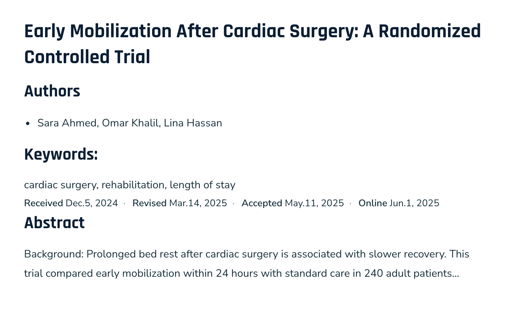

# Article Timeline

An OJS 3.5 plugin that shows the editorial history of an article on its landing
page — when it was received, revised, accepted and published online:

> **Received** Dec.5, 2024 · **Revised** Mar.14, 2025 · **Accepted** May.11, 2025 · **Online** Jun.1, 2025



*The default position, above the abstract (OJS article page, sample content).*

## How dates are derived

| Label | Source |
|---|---|
| Received | `submissions.date_submitted` |
| Revised | Latest upload of a review-revision file (file stages 15/20) |
| Accepted | `date_decided` of the last **Accept** editorial decision |
| Online | `date_published` of the first publication |

Dates that are not available for an article are left out; when none is
available, nothing is shown.

## Settings

Per journal, under Settings → Website → Plugins → Article Timeline → Settings.

**Display position**

| Option | Where it appears |
|---|---|
| Main column (above the abstract) | Between the keywords and the abstract. **Default.** |
| Main column (under the abstract) | Right after the abstract |
| Sidebar (details column) | As a block in the article's details column |

"Above the abstract" looks for the theme's `<section class="…abstract…">`
(default theme and individualizeTheme). On a page without one, the timeline
stays under the abstract instead.

**Date format** — a PHP date format string. Default `M.j, Y` → "Dec.5, 2024";
`d/m/Y` → "05/12/2024", `F j, Y` → "December 5, 2024". Month names follow the
reader's language.

Interface strings are available in English and Arabic.

## Installation

1. Download `articleTimeline-<version>.tar.gz` from the
   [latest release](https://github.com/alaidi/articleTimeline/releases/latest).
2. In OJS, go to Settings → Website → Plugins → **Upload a New Plugin** and
   upload the file. To upgrade, use **Upgrade** on the plugin's row instead.
3. Enable **Article Timeline** in the list of generic plugins.

Or copy the `articleTimeline` folder into `plugins/generic/` and run
`php tools/upgrade.php upgrade`.

Requires OJS 3.5.0 or later.

## Development

The tests follow PKP's plugin layout and run in
[PKP's GitHub Actions](https://github.com/pkp/pkp-github-actions) on every push
(OJS `stable-3_5_0`, PHP 8.2/8.3, MySQL/PostgreSQL):

- `tests/` — PHPUnit: placement of the timeline, stored positions, the date format,
  locale files in sync, template safety (CSRF, escaping, headers), and class
  compatibility with the installed PKP version.
- `cypress/tests/functional/` — the three positions in the settings and on an article page.

To run them in an OJS development checkout (with `composer install` dev dependencies),
from the OJS root:

```sh
php lib/pkp/lib/vendor/bin/phpunit --configuration lib/pkp/tests/phpunit.xml --no-coverage plugins/generic/articleTimeline/tests
npx cypress run --config '{"specPattern":["plugins/generic/articleTimeline/cypress/tests/functional/*.cy.js"]}' --env contextPath=<journal>,adminUser=<user>,adminPassword=<password>
```

See [CONTRIBUTING.md](CONTRIBUTING.md) for releasing.
