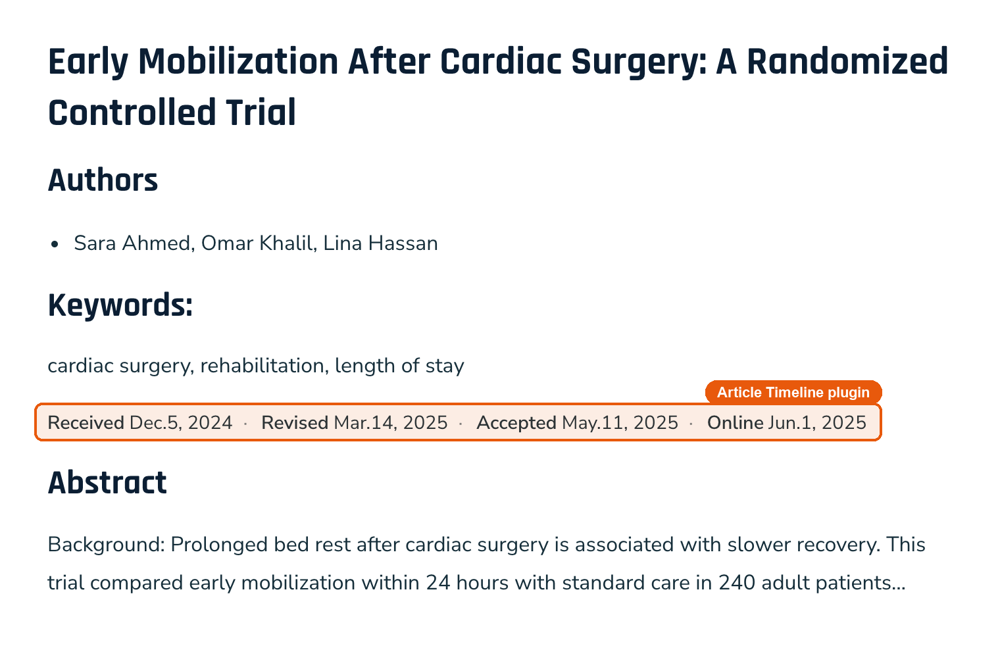

# Article Timeline

An OJS 3.5 plugin that shows the editorial history of an article on its landing
page — when it was received, revised, accepted and published online:

> **Received** Dec.5, 2024 · **Revised** Mar.14, 2025 · **Accepted** May.11, 2025 · **Online** Jun.1, 2025



*The default position, above the abstract (OJS article page, sample content).*

## How dates are derived

All four come from the OJS API (submission, submission files, editorial decisions,
publications); the plugin runs no SQL of its own.

| Label | Source |
|---|---|
| Received | The submission's date submitted |
| Revised | The latest review-revision file **uploaded by one of the submission's authors**, not later than the acceptance |
| Accepted | The date of the last **Accept** or **Accept and Skip Review** decision |
| Online | The earliest publication date among the article's **published** versions |

Dates that are not available for an article are left out; when none is
available, nothing is shown. Dates are shown as stored, in the server's time
zone, without conversion.

### Limitations of the Revised date

OJS does not record when an author "resubmitted"; the plugin takes the upload
time of the files in the review stage's *Revisions* area:

- A file an editor or administrator uploads there for the author (for example a
  revision that arrived by email) is **not** counted, because OJS cannot tell it
  apart from an editor's own file. Such an article shows no Revised date unless
  the author also uploaded one.
- A file uploaded after the acceptance is ignored, so Revised never follows Accepted.
- When an author replaces a revision file with a new version of the same file,
  the date stays that of the first upload.
- With several review rounds, the latest author revision is used.

## Settings

Per journal, under Settings → Website → Plugins → Article Timeline → Settings.

**Display position**

| Option | Where it appears |
|---|---|
| Main column (above the abstract) | Between the keywords and the abstract. **Default.** |
| Main column (under the abstract) | Right after the abstract |
| Sidebar (details column) | As a block in the article's details column |

"Above the abstract" looks for the first `<section>` or `<div>` whose class is
`abstract` or ends in `-abstract` (default theme: `item abstract`,
individualizeTheme: `article-section-abstract`), whatever the attribute order or
quotes. On a page without one, the timeline stays under the abstract instead.

**Date format** — a PHP date format string that shows a day, month or year
(time-only formats such as `H:i` are refused). Default `M.j, Y` → "Dec.5, 2024";
`d/m/Y` → "05/12/2024", `F j, Y` → "December 5, 2024". Month names follow the
reader's language.

Interface strings are available in English and Arabic; the timeline follows the
page direction (RTL in Arabic). Each date is a `<time datetime="YYYY-MM-DD">`
element, and the main-column timeline is announced as a list named "Article History".
Its CSS classes start with `article-timeline` for styling from a theme or the
journal stylesheet.

## Installation

1. Download `articleTimeline-<version>.tar.gz` from the
   [latest release](https://github.com/alaidi/articleTimeline/releases/latest).
2. In OJS, go to Settings → Website → Plugins → **Upload a New Plugin** and
   upload the file. To upgrade, use **Upgrade** on the plugin's row instead.
3. Enable **Article Timeline** in the list of generic plugins.

Or copy the `articleTimeline` folder into `plugins/generic/` and run
`php tools/upgrade.php upgrade`.

**Upgrading** keeps the saved position and date format: the setting names and
stored values (`main`, `mainBelow`, `sidebar`) are unchanged since 1.0.

Requires OJS 3.5.0 or later. Tested on OJS 3.5.0-3 (PHP 8.5, MySQL 8). PKP's CI
runs the tests on OJS `stable-3_5_0` with PHP 8.2/8.3 and MySQL/PostgreSQL.

## Development

The tests follow PKP's plugin layout and run in
[PKP's GitHub Actions](https://github.com/pkp/pkp-github-actions) on every push
(OJS `stable-3_5_0`, PHP 8.2/8.3, MySQL/PostgreSQL):

- `tests/` — PHPUnit: how each of the four dates is chosen (missing dates, several
  revisions or decisions, revisions after acceptance, draft versions), placement of
  the timeline for different abstract markup, stored settings, date-format
  validation, locale files in sync, template safety (CSRF, escaping, headers), and
  class compatibility with the installed PKP version.
- `cypress/tests/functional/` — the three positions in the settings and on an article
  page, refusal of a date format without a date, and the layout on a 320px screen.

To run them in an OJS development checkout (with `composer install` dev dependencies),
from the OJS root:

```sh
php lib/pkp/lib/vendor/bin/phpunit --configuration lib/pkp/tests/phpunit.xml --no-coverage plugins/generic/articleTimeline/tests
npx cypress run --config '{"specPattern":["plugins/generic/articleTimeline/cypress/tests/functional/*.cy.js"]}' --env contextPath=<journal>,adminUser=<user>,adminPassword=<password>
```

See [CONTRIBUTING.md](CONTRIBUTING.md) for releasing.

## Version history

- **1.2.0.0** — Accepted also counts "Accept and Skip Review"; Revised counts only
  author uploads, not after the acceptance; Online ignores unpublished draft versions;
  date format must show a date, with an error message in the settings; the date is
  HTML-escaped; abstract detection accepts any attribute order and quotes, and `<div>`
  blocks; the timeline is rendered once per page; `<time>` elements and list semantics;
  entries wrap instead of being cut off on narrow screens.
- **1.1.0.1** — Own spacing for themes that don't pad `.item`.
- **1.1.0.0** — "Under the abstract" position; tests and CI.
- **1.0.2.0** — Compact date format, clean separators when the row wraps.
- **1.0.1.0** — Timeline above the abstract.
- **1.0.0.0** — First release.
